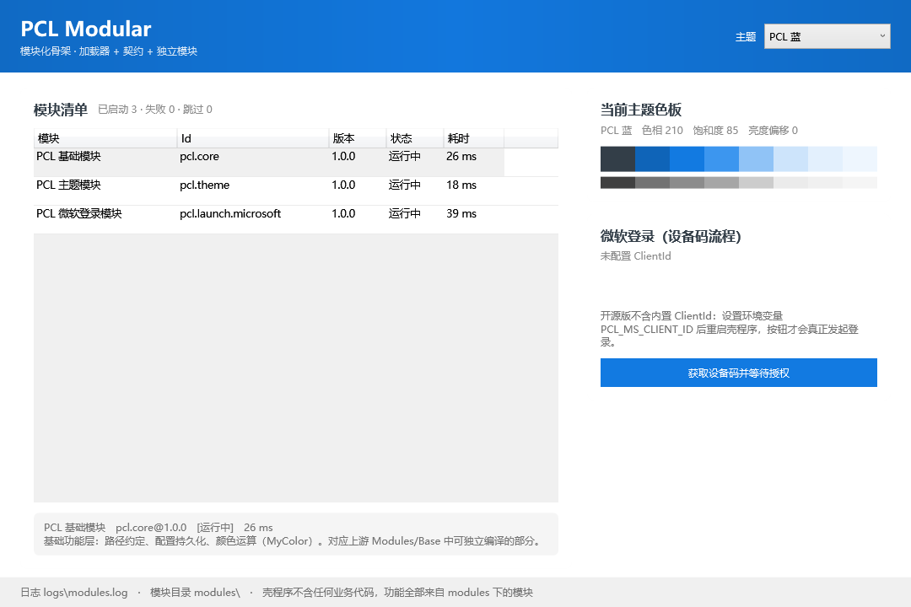
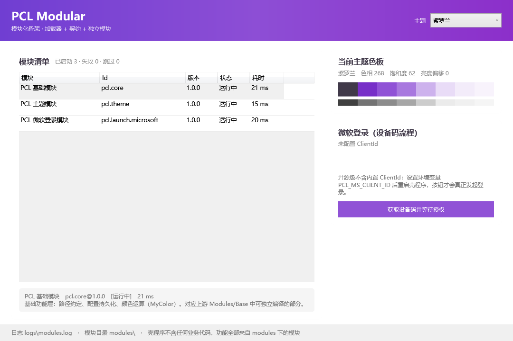

# PCL 多模块化改造

把 PCL（Plain Craft Launcher 2，VB.NET / .NET Framework 4.8 / WPF）从**单程序集全局状态**
改成**模块加载器 + 契约 + 独立模块**的结构。

本目录是改造后的骨架，**不动**仓库里原有的 `Plain Craft Launcher 2/` 单体工程：
它作为对照实现保留，随时可以和上游 `Meloong-Git/PCL` 同步，不会因为改造而失去追溯能力。

## 一、为什么不能"直接把文件搬到新工程"

PCL 原本是一个程序集里的全局状态机：

- 页面直接读 `ModMain`、`States`、`FrmMain.PanXXX`；
- 模块之间互相 `Public Module` 直接调用，没有接口；
- 主题靠直接改 `Application.Current.Resources` 并抓住 `FrmMain.PanTitle`。

所以"拆"不是挪文件，而是**先立契约，再让代码只依赖契约**。本次改造按这个顺序落地：
先做契约与加载器，再把可以独立的部分（基础功能 / 主题 / 微软登录）真正编成独立程序集，
最后才动 UI（UI 依赖面最大，见各 UI 仓库的 `MIGRATION.md`）。

## 二、目录

```
modular/
├── PCL.Modular.sln
├── src/
│   ├── PCL.Modular.Abstractions/   契约：IPclModule、清单、服务表、跨模块接口
│   ├── PCL.Modular.Host/           模块加载器（本目录的主角）
│   ├── PCL.Modular.Cli/            加载器验证器（含故障注入用例）
│   ├── PCL.Core/                   基础模块：路径、配置、MyColor
│   ├── PCL.Theme/                  主题模块：HSL 调色 + 资源注入
│   ├── PCL.Launch.Microsoft/       微软登录模块：设备码 → XBL → XSTS → MC
│   └── PCL.Shell/                  壳程序：只有窗口和加载逻辑，没有业务代码
└── verify.cmd                      一键构建 + 两组验证
```

模块之间**不互相引用程序集**：需要别人的能力，就从 `IModuleContext.Services` 按接口取。
跨模块接口统一放在 `PCL.Modular.Abstractions/Contracts.cs`。

## 三、模块清单

| 模块 Id | 工程 | 依赖 | 对应上游 | 状态 |
| --- | --- | --- | --- | --- |
| `pcl.core` | PCL.Core.vbproj | — | `Modules/Base`（路径、MyColor）、`Settings` | ✅ 可编译可加载 |
| `pcl.theme` | PCL.Theme.vbproj | pcl.core | `ModSecret` 主题区域 + `Application.xaml` 颜色表 | ✅ 可编译可加载 |
| `pcl.launch.microsoft` | PCL.Launch.Microsoft.vbproj | pcl.core | `ModLaunch.McLoginMsStart` / `MsLoginStep1~6` | ✅ 可编译可加载 |
| `pcl.ui.*` | 各自独立仓库 | pcl.core / pcl.theme / pcl.ui.controls | `Pages/*`、`Controls/` | 🚧 源码已归位，适配中 |

UI 模块在独立仓库里，见 `ARCHITECTURE.md` 的仓库表。

## 四、跑起来是什么样

壳程序本身没有任何业务代码，界面上的东西全部来自模块：

| 默认主题 | 切换到紫罗兰 |
| --- | --- |
|  |  |

两张图是同一份代码离屏渲染出来的（`--render`），颜色差异来自 `pcl.theme` 真的改了资源字典。

## 五、构建与验证
```bat
cd modular
dotnet build PCL.Modular.sln
```

一键验证（构建 + 故障注入 + 真实模块加载）：

```bat
modular\verify.cmd
```

单独跑：

```bat
:: 真实模块
src\PCL.Modular.Cli\bin\Debug\PCL.Modular.Cli.exe --modules src\PCL.Shell\bin\Debug\modules

:: 故障注入：造出坏 JSON / 缺 dll / OnLoad 抛异常 / 循环依赖 / 重复 Id，确认加载器会判红
src\PCL.Modular.Cli\bin\Debug\PCL.Modular.Cli.exe --inject-fault
```

界面（离屏渲染，不需要人盯着看）：

```bat
src\PCL.Shell\bin\Debug\PCL.Shell.exe --render preview.png --theme violet
```

## 六、加载器规则（刻意做成可判定）

1. **只认 `module.json`**，不扫程序集特性，不猜约定；
2. **依赖拓扑排序**，循环依赖整组判失败，不做"尽力加载"；
3. **单个模块失败只影响它和它的下游**：下游标记为"已跳过"并写明是哪个依赖挂了；
4. **重复 Id 只保留最高版本**，其余显式记失败（不允许悄悄生效）；
5. **`OnStart` 逆序 `OnStop`**，退出时按依赖反向收尾。

这些规则每一条都有对应的注入用例，`--inject-fault` 会逐条验证。

## 七、本体工程翻新

`Plain Craft Launcher 2/Plain Craft Launcher 2.vbproj` 从老式工程（ToolsVersion 15、逐个文件列举）改成 SDK 风格，
现在**不用装 Visual Studio 也能 `dotnet build`**：

| 项 | 翻新前 | 翻新后 |
| --- | --- | --- |
| 文件清单 | 手工维护 112 个 `<Compile>` / 60 个 `<Page>` / 52 个 `<Resource>` | MSBuild 自动收集 |
| 配置 | Debug 与 Snapshot 都定义 `SNAPSHOT`，靠 VS 切换 | Debug / Release / Snapshot 三个条件组，一眼看清 |
| 参考程序集 | 依赖机器上装 VS 的 .NET Framework Developer Pack | 引 `Microsoft.NETFramework.ReferenceAssemblies` 包，任何机器 `dotnet build` 可编 |
| 全局 Imports | 30 条 | 原样保留（代码里从不写 Imports，少一条就是成片"未定义类型"） |

翻新时踩到、并且已经写进工程注释的三个坑：

1. **自动 glob 不等于老工程清单**。`Controls/MySliderDot.xaml(.vb)` 在磁盘上，但老工程从来没编译过它
   （引用了 `MathRange` / `SetTop` / `FrmMain.SliderDrag_Finish` 等根本不存在的成员，是上游遗留的死文件）。
   SDK 会自动把它捡进来，必须显式 `Remove`。核对方法：老工程 `<Compile>` 112 条 vs 磁盘 113 个 `.vb`，差的就是它。
2. **`Application.xaml` 不叫 `App.xaml`**。SDK 默认只把 `App.xaml` 当 `ApplicationDefinition`，
   这里要关掉默认项再显式声明，否则会被当成普通 Page，`Main` 就没了。
3. **`AssemblyName` 必须保持 `Plain Craft Launcher 2`**。代码里所有
   `pack://application:,,,/Plain Craft Launcher 2;component/Images/...` 都靠它，改名等于全站图片失联。

验证结果：

- `dotnet build` → **0 警告 0 错误**，产出 `bin\Plain Craft Launcher 2.exe` 与全部依赖；
- 直接启动本体，`PCL\Log1.txt` 里能看到完整的初始化链路（模块加载 → Java 扫描 → 版本列表拉取 → 主窗口 DPI），
  界面正常渲染：


