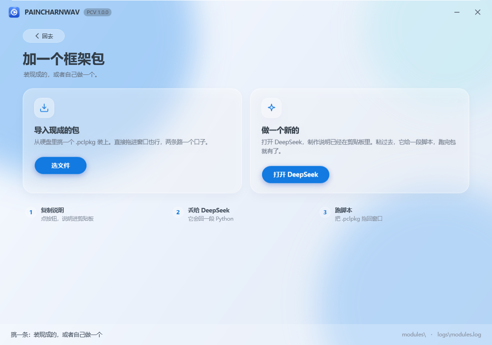
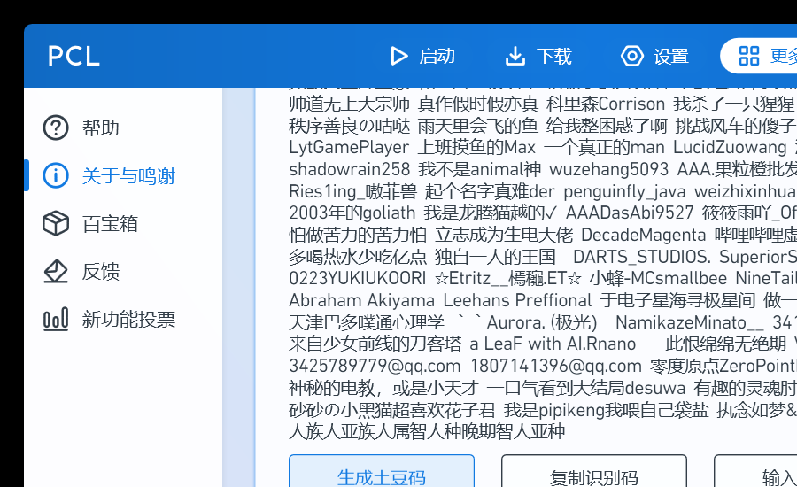

# PAINCHARNWAV（PCV）

> 名字：**PAINCHARNWAV**，日常叫 **PCV**。代码里的 `pcl.*` 模块 Id 没改——那是底层框架的名字，
> 改它等于把所有已装包的路径全打乱，不值当。

把 PCL（Plain Craft Launcher 2，VB.NET / .NET Framework 4.8 / WPF）从**单程序集全局状态**
改成**模块加载器 + 契约 + 独立模块**的结构，再在外面套一层自己的壳。

本目录是改造后的骨架，**不动**仓库里原有的 `Plain Craft Launcher 2/` 单体工程：
它作为对照实现保留，随时可以和上游 `Meloong-Git/PCL` 同步，不会因为改造而失去追溯能力。

## 一、为什么不能"直接把文件搬到新工程"

PCL 原本是一个程序集里的全局状态机：

- 页面直接读 `ModMain`、`States`、`FrmMain.PanXXX`；
- 模块之间互相 `Public Module` 直接调用，没有接口；
- 主题靠直接改 `Application.Current.Resources` 并抓住 `FrmMain.PanTitle`。

所以"拆"不是挪文件，而是**先立契约，再让代码只依赖契约**。本次改造按这个顺序落地：
先做契约与加载器，再把可以独立的部分（基础功能 / 主题 / 微软登录）真正编成独立程序集，
最后才动 UI（UI 依赖面最大，见各 UI 仓库的 `MIGRATION.md`）。

## 二、目录

```
modular/
├── PCL.Modular.sln
├── src/
│   ├── PCL.Modular.Abstractions/   契约：IPclModule、清单、服务表、跨模块接口
│   ├── PCL.Modular.Host/           模块加载器（本目录的主角）
│   ├── PCL.Modular.Cli/            加载器验证器（含故障注入用例）
│   ├── PCL.Core/                   基础模块：路径、配置、MyColor
│   ├── PCL.Theme/                  主题模块：HSL 调色 + 资源注入
│   ├── PCL.Launch.Microsoft/       微软登录模块：设备码 → XBL → XSTS → MC
│   └── PCL.Shell/                  壳程序：只有窗口和加载逻辑，没有业务代码
└── verify.cmd                      一键构建 + 两组验证
```

模块之间**不互相引用程序集**：需要别人的能力，就从 `IModuleContext.Services` 按接口取。
跨模块接口统一放在 `PCL.Modular.Abstractions/Contracts.cs`。

## 三、模块清单

| 模块 Id | 工程 | 依赖 | 对应上游 | 状态 |
| --- | --- | --- | --- | --- |
| `pcl.core` | PCL.Core.vbproj | — | `Modules/Base`（路径、MyColor）、`Settings` | ✅ 可编译可加载 |
| `pcl.theme` | PCL.Theme.vbproj | pcl.core | `ModSecret` 主题区域 + `Application.xaml` 颜色表 | ✅ 可编译可加载 |
| `pcl.launch.microsoft` | PCL.Launch.Microsoft.vbproj | pcl.core | `ModLaunch.McLoginMsStart` / `MsLoginStep1~6` | ✅ 可编译可加载 |
| `pcv.diagnostics` | Pcv.Diagnostics.csproj | pcl.core | 新增 | ✅ 可编译可加载 |
| `pcv.stat` | Pcv.Stat.csproj | pcl.core | 新增 | ✅ 可编译可加载 |
| `pcv.cleaner` | Pcv.Cleaner.csproj | pcl.core | 新增 | ✅ 可编译可加载 |
| `pcl.demo.hello` | PCL.Demo.Hello.vbproj | pcl.core | 示例 | ✅ 可编译可加载 |
| `pcl.ui.*` | 各自独立仓库 | pcl.core / pcl.theme / pcl.ui.controls | `Pages/*`、`Controls/` | 🚧 源码已归位，适配中 |

UI 模块在独立仓库里，见 `ARCHITECTURE.md` 的仓库表。

## 四、跑起来是什么样

整个程序**只有一页**：拖包 → 装 → 立刻可用。左边是刚启动的样子，右边是拖进示例框架之后的样子。

| 首页 | 点"选框架包"之后的第二页 |
| --- | --- |
|  |  |

两张图都是同一份代码离屏渲染出来的（`--render`），不是画的效果图。

## 五、构建与验证
```bat
cd modular
dotnet build PCL.Modular.sln
```

一键验证（构建 + 故障注入 + 真实模块加载）：

```bat
modular\verify.cmd
```

单独跑：

```bat
:: 真实模块
src\PCL.Modular.Cli\bin\Debug\PCL.Modular.Cli.exe --modules src\PCL.Shell\bin\Debug\modules

:: 故障注入：造出坏 JSON / 缺 dll / OnLoad 抛异常 / 循环依赖 / 重复 Id，确认加载器会判红
src\PCL.Modular.Cli\bin\Debug\PCL.Modular.Cli.exe --inject-fault
```

界面（离屏渲染，不需要人盯着看）：

```bat
src\PCL.Shell\bin\Debug\PCL.Shell.exe --render preview.png --theme violet
```

## 六、加载器规则（刻意做成可判定）

1. **只认 `module.json`**，不扫程序集特性，不猜约定；
2. **依赖拓扑排序**，循环依赖整组判失败，不做"尽力加载"；
3. **单个模块失败只影响它和它的下游**：下游标记为"已跳过"并写明是哪个依赖挂了；
4. **重复 Id 只保留最高版本**，其余显式记失败（不允许悄悄生效）；
5. **`OnStart` 逆序 `OnStop`**，退出时按依赖反向收尾。

这些规则每一条都有对应的注入用例，`--inject-fault` 会逐条验证。

## 七、本体工程翻新

`Plain Craft Launcher 2/Plain Craft Launcher 2.vbproj` 从老式工程（ToolsVersion 15、逐个文件列举）改成 SDK 风格，
现在**不用装 Visual Studio 也能 `dotnet build`**：

| 项 | 翻新前 | 翻新后 |
| --- | --- | --- |
| 文件清单 | 手工维护 112 个 `<Compile>` / 60 个 `<Page>` / 52 个 `<Resource>` | MSBuild 自动收集 |
| 配置 | Debug 与 Snapshot 都定义 `SNAPSHOT`，靠 VS 切换 | Debug / Release / Snapshot 三个条件组，一眼看清 |
| 参考程序集 | 依赖机器上装 VS 的 .NET Framework Developer Pack | 引 `Microsoft.NETFramework.ReferenceAssemblies` 包，任何机器 `dotnet build` 可编 |
| 全局 Imports | 30 条 | 原样保留（代码里从不写 Imports，少一条就是成片"未定义类型"） |

翻新时踩到、并且已经写进工程注释的三个坑：

1. **自动 glob 不等于老工程清单**。`Controls/MySliderDot.xaml(.vb)` 在磁盘上，但老工程从来没编译过它
   （引用了 `MathRange` / `SetTop` / `FrmMain.SliderDrag_Finish` 等根本不存在的成员，是上游遗留的死文件）。
   SDK 会自动把它捡进来，必须显式 `Remove`。核对方法：老工程 `<Compile>` 112 条 vs 磁盘 113 个 `.vb`，差的就是它。
2. **`Application.xaml` 不叫 `App.xaml`**。SDK 默认只把 `App.xaml` 当 `ApplicationDefinition`，
   这里要关掉默认项再显式声明，否则会被当成普通 Page，`Main` 就没了。
3. **`AssemblyName` 必须保持 `Plain Craft Launcher 2`**。代码里所有
   `pack://application:,,,/Plain Craft Launcher 2;component/Images/...` 都靠它，改名等于全站图片失联。

验证结果：

- `dotnet build` → **0 警告 0 错误**，产出 `bin\Plain Craft Launcher 2.exe` 与全部依赖；
- 直接启动本体，`PCL\Log1.txt` 里能看到完整的初始化链路（模块加载 → Java 扫描 → 版本列表拉取 → 主窗口 DPI），
  界面正常渲染：



## 八、单页 + 功能框架包（2026-11-05 追加）

### 只有一页

壳里没有导航、没有侧边栏、没有设置页。页面上只有三件事：
**拖放区**（拖 .pclpkg 进来）、**已装框架列表**、**状态栏**。
所有能力都来自 `modules/`，壳自己不含任何业务逻辑。

### 包格式 `.pclpkg`

就是一个 zip，根目录放 `module.json`（允许套一层文件夹）：

```
module.json          # id / name / version / assembly / entry / dependencies
PCL.Xxx.dll          # 模块本体
（可选）其它依赖 dll
```

打包用 `tools/pack_module.py <构建输出目录> <输出.pclpkg>`，只收白名单扩展名，不会把 pdb、日志混进去。

### 安装流程（`PCL.Modular.Packages`）

顺序是刻意的——**所有校验都在动盘之前，所有写入都在 staging 里，最后一步才原子提交**：

| 步骤 | 做什么 | 失败时 |
| --- | --- | --- |
| 1 检查 | 读清单、查路径穿越、条目数与解压体积、程序集是否存在、依赖是否已装、宿主版本 | 直接拒绝，磁盘不变 |
| 2 解压 | 解到 `modules/.staging/<id>-<随机>` | 清掉 staging |
| 3 记录 | 写 `install.json`（来源、sha256、时间） | 清掉 staging |
| 4 备份 | 已存在同 Id 且用户确认覆盖时，旧目录挪到 `modules/.backup/` | —— |
| 5 提交 | `Directory.Move` 原子改名到 `modules/<id>/` | 自动把备份挪回原位 |
| 6 生效 | 调用 `ModuleHost.ReloadAll()` 重新走一遍加载 | 新框架标记失败并报原因 |

卸载不会假装"删干净"：它只把目录挪进 `modules/.trash/`。.NET Framework 里已加载的程序集卸不掉，
**如实告诉用户"重启后彻底生效"**，比骗自己强。

### 验证

```bat
:: 安装器故障注入：坏包 / zip slip / 缺依赖 / 缺程序集 / 重复安装 / 覆盖 / 卸载
PCL.Modular.Cli.exe --package-selftest      → 13/13 通过

:: 真装一个
PCL.Modular.Cli.exe --modules <目录> --install dist\PCL.Demo.Hello-1.0.0.pclpkg
PCL.Modular.Cli.exe --modules <目录>                 → 4 个模块，全部运行中
```

### 液态玻璃的来路

视觉方案参考了两个 GitHub 项目，最后选的是后者的路子：

- [trrahul/glassmorphism-wpf](https://github.com/trrahul/glassmorphism-wpf) —— 三种实现对比（SkiaSharp 实时采样 / 基础 Skia / 纯 XAML）。
  本项目用的是它 **GlassmorphismXaml** 那一路：`BlurEffect` 光斑 + 半透明层 + 边缘高光。
- [TianXiaTech/BlurWindow](https://github.com/TianXiaTech/BlurWindow) —— 用 `SetWindowCompositionAttribute` 让窗口真的透出桌面。
  **没用它**：Win11 22H2 之后行为不稳定，失败时整窗发黑。宁可稳，不要赌。

所以"玻璃"是自己画出来的：背景三颗大模糊光斑 + 半透明白面板 + 1px 白色高光边 + 柔和外阴影，
外加 Win11 原生圆角（`DWMWA_WINDOW_CORNER_PREFERENCE`）。不依赖系统合成器，任何机器看起来一致。

## 九、本体清理（把原作者那套东西摘掉）

`tools/strip_donation.py` 逐处精确替换，**任何一处没命中就整体报错**，不会留下半截代码。删掉的东西：

| 位置 | 删除内容 |
| --- | --- |
| `Modules/ModSecret.vb` | 整个「赞助等级」区：`CurrentRank` / `InputPotatoCode` / `GeneratePotatoCode` / `GetIdentify` |
| `Modules/Base/ModBase.vb` | `Identify` 字段（对外可兑换的识别码） |
| `FormMain.xaml.vb` | 启动上报 `Telemetry`、「开源版本说明」弹窗、快照版赞助者说明、99 次解锁提示 |
| `Modules/Minecraft/ModLaunch.vb` | 启动次数达标时的求赞助弹窗 |
| `Pages/PageOther/PageOtherAbout.xaml` | 「赞助者」整张卡片（数百条名单 + 生成/输入土豆码/复制识别码/赞助作者四个按钮）、「赞助 PCL!」「赞助镜像源」按钮 |
| `Pages/PageSetup/PageSetupSystem.xaml` | 「复制识别码 / 输入土豆码」整行 |
| `Pages/PageSetup/PageSetupUI.xaml` | 「赞助解锁主题」横幅、土豆码解锁提示 |
| `Pages/PageLaunch/PageLaunchRight.xaml` | 快照版赞助者提示条 |
| `Application.xaml.vb` | 启动日志里打印识别码 |

**保留**的一处：设置加密与联机主机名原本用识别码当盐，现在改成 `DeviceSalt`（本地常量，不展示、不绑定账号、
换不到任何东西）。不留这个盐，老设置解不开、联机主机名也对不上——这是把它降级成本地技术细节，而不是继续当身份凭证。

验证：`dotnet build "Plain Craft Launcher 2.sln"` → **0 警告 0 错误**；源码里已无
`CurrentRank / DonationRank / InputPotatoCode / GetIdentify / 土豆码 / 赞助` 的引用。

## 十、制作自己的框架包（2026-11-05 追加）

首页点「选框架包」进第二页，两条路：**导入现成的** 或 **做一个新的**。

点「打开 DeepSeek」会做两件事：把制作说明写进剪贴板，然后打开 `chat.deepseek.com`。
说明全文在 `assets/prompt-framework.md`，嵌进了程序集（`PCV.prompt-framework.md`），
不会因为文件被挪走就失效。

### 那份说明要求 AI 输出什么

DeepSeek 不能直接给文件，所以说明里把它逼到一个格式上：**只准输出一个 Python 脚本**。
脚本自己干完这些事：

1. 写 `module.json`、`.csproj`、入口 `.cs`；
2. 调 `dotnet build -c Release` 编出 dll；
3. 把 `module.json` 和 dll 打进 `.pclpkg`；
4. 打印包的绝对路径，出错非 0 退出。

说明里还附了一份能直接跑的骨架（`PCV_DIR`、`id`、入口类都留了 TODO），
AI 只要替换内容就行，不用它自己发明结构。契约程序集路径写的是
`{PCV 安装目录}\PCL.Modular.Abstractions.dll`，`Private=false`，包里不会多带一份。

### 这条链验证到哪一步

- 提示词已嵌入：`PCV.exe --copy-prompt` → `promptChars=4405 clipboard=True`（退出码 0）；
- 剪贴板内容外部读回，4405 字，首尾都对；
- 生成的包能装：`PCL.Demo.Hello-1.0.0.pclpkg` 就是这个格式，装完 4 个模块都在跑。

**没验证的部分**：没有真的拿 DeepSeek 生成一遍再装。这一步要人去看它的输出，
我能保证的是"说明足够明确 + 产物格式与安装器检查项一一对应"，不是"AI 一定写对"。

### 剪贴板为什么不用 WPF 的 Clipboard

这台机器上 `Clipboard.SetDataObject` 一直抛 `CLIPBRD_E_CANT_OPEN`（重试 8 次也不行），
换成 Win32 的 `OpenClipboard` / `SetClipboardData` 一次就过。代码在 `ClipboardWriter.cs`，
注释里写了原因——免得以后有人"顺手改回 WPF 的写法"。

## 十一、三个现成的小框架（2026-11-05 追加）

自己动手做的三个包，都能直接用，源码在 `src/Pcv.*`，成品在 `dist/`：

| 包 | 干什么 | 装完能看到什么 |
| --- | --- | --- |
| `pcv.diagnostics` 环境自检 | 系统版本、CLR、位数、磁盘余量、模块目录是否可写、装了几个包、配置几条 | `logs\diagnostics-<时间>.txt` 一份报告 |
| `pcv.stat` 使用统计 | 第几次打开、从哪天开始用、累计多久这、次开了多久 | 日志一行；数字存在本地 `PCLData\settings.json` |
| `pcv.cleaner` 垃圾清理 | 清 3 天前的 `.trash`、7 天前的 `.backup`、两周前的日志 | 日志里逐条写"删了哪个"，没得清就说没得清 |

三个都验过：装进壳里之后 `7 个跑着 / 一共 7 个`，自检报告里的系统行是
`Windows 11 Pro 26H2 (build 26300)`，统计配置里 `StatStarts` 会真的加一。

两处当时踩到的细节，留在代码注释里了：

- 包一开始有 700 KB，因为 `PCL.Modular.Abstractions` 的 Newtonsoft 依赖被一起复制了。
  给模块加 `ExcludeAssets="runtime"` 之后降到 3~5 KB —— 模块不该替宿主带依赖。
- `Environment.OSVersion` 在这个进程里把 Win11 报成 `6.2.9200`（Win8），因为进程没声明支持的系统版本。
  改成读注册表 `CurrentBuild`，并且 build ≥ 22000 时把名字里的 "Windows 10" 换回 "Windows 11"
  ——微软自己在注册表里都还写着 Windows 10。
